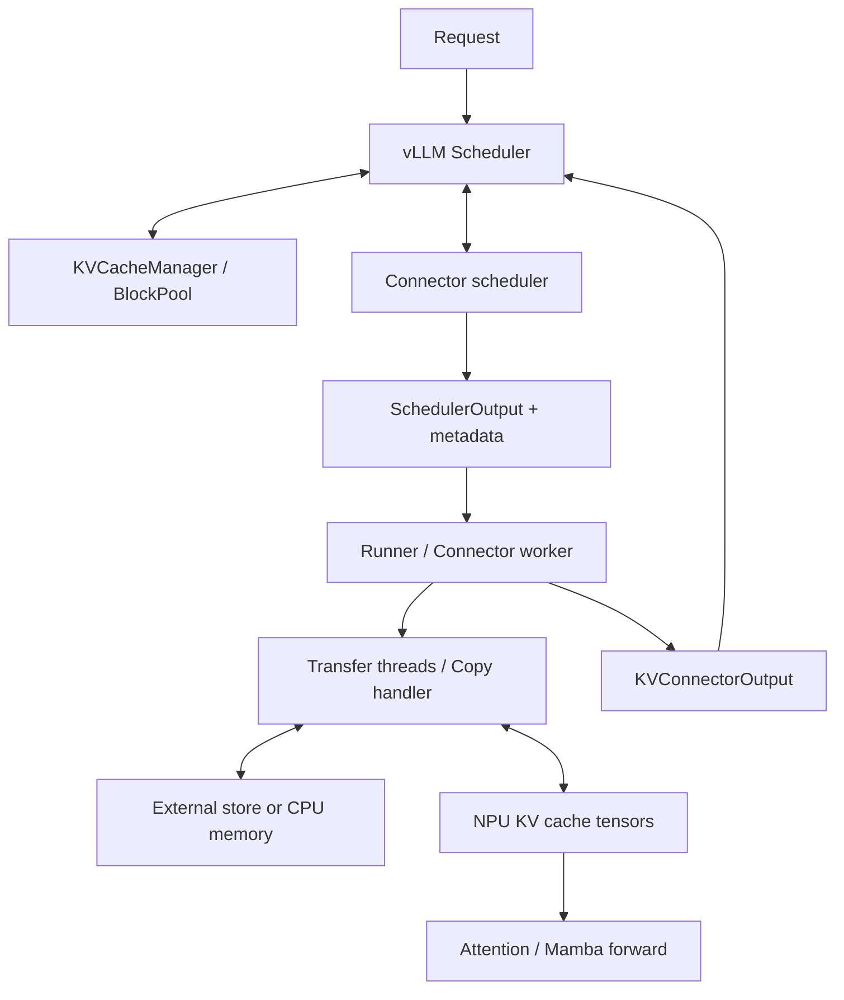

# 01. KV Pool 在 vLLM Ascend 中处于什么位置？

版本及可点击源码入口统一见 [00 源码基线](00_source_baseline.md)。

`kv_pool` 是 Ascend KV Connector 实现及其设备适配的集合。它负责外部 KV 复用和本地 offload；请求调度、本地 block 分配和模型计算各有自己的所有者。

## 1. 五层边界

| 层 | 所有者 | 负责 | 交给下一层的内容 |
|---|---|---|---|
| 请求与调度 | vLLM `Scheduler` | 选择请求、token 预算、抢占、失败策略 | 本轮请求和计算范围 |
| 本地 block 账本 | `KVCacheManager` / `BlockPool` | prefix cache、allocation/free、引用计数 | 每 group 的 block ids |
| connector 控制面 | 各 connector scheduler | 外部命中、传输意图、状态追踪 | `KVConnectorMetadata` |
| Worker 编排与执行 | connector worker / runner / transfer threads | 把 block ids 转地址，提交/等待 I/O | 实际 tensor 数据和完成/失败结果 |
| 存储或内存层级 | backend / CPU buffer | 对象、GVA、session、CPU page | 可恢复 KV 或操作结果 |



metadata 是计划，不是 KV payload。Worker 的 tensor 注册表把计划里的逻辑 block id 变成当前进程可访问的设备地址。

## 2. 当前目录的实现集合

```text
kv_pool/
  ascend_store/                  外部对象池；本体系的主线
    backend/                     Mooncake / MemCache / YuanRong
    dspark_prefix_cache.py       draft/auxiliary prefix companion
    metrics.py                   connector 统计
  kv_offload/
    native/                      对接上游 native CPU/tiering offload
    simple/                      对接上游 simple CPU offload
    preempt_offload/              抢占时保存真实 KV，恢复时加载
  ucm_connector/                 委托外部 UCM 实现
```

当前没有 `kv_pool/recompute_cpu_offload/`。不能继续用“不保存完整 KV 的重计算路径”描述现有 PreemptOffload；它的目标恰好是保存 KV，减少抢占后的重算。

## 3. AscendStore 内部还有三种数据面

| 数据面 | 代表路径 | 保存单位 | 生命周期 |
|---|---|---|---|
| object | 非 layerwise；无专用协议的 KeyLayer 分支 | `PoolKey` 或 `LayerPoolKey` | `exists/get/put` |
| GVA | MemCache layerwise | 一个逻辑 block 的层栈对象，层数据用 offset 定位 | alloc/lease/copy/write finish |
| block-key range | Mooncake layerwise | block/group/stage 对象 | put/get session + 按层 range + commit/end |

`use_layerwise` 控制每层执行；`layerwise_data_plane` 决定对象协议；`layerwise_offload` 表示当前 layout 是否真的复用 HBM。三个概念必须分开。

## 4. 两种 block、三种地址

- **vLLM block**：有本地 id、引用计数和 prefix 语义，由 `BlockPool` 管理。
- **传输 chunk/object**：按 hash、group、并行坐标和 backend 协议定位，可能覆盖多层/多个 tensor。

| 地址/索引 | 含义 |
|---|---|
| 本地 block id | tensor 中的逻辑页索引，不能当 pointer |
| 本地 `data_ptr + stride/offset` | NPU buffer 的实际访问地址 |
| 外部 GVA / object range offset | 后端对象的寻址信息，不是本地 block id |

一个 key 可由多个不连续本地片段组成，因此 `Backend.put/get` 的地址和 size 是二维列表。缓存注册也不等于建立外部存储池：注册的是可传输的本地内存，外部容量由 backend 配置和服务决定。

## 5. 最小生命周期与资源安全

```text
查询本地 prefix
  -> connector 查询可恢复前缀
  -> vLLM allocate_slots
  -> update_state_after_alloc
  -> build_connector_meta
  -> Worker bind / handle_preemptions
  -> load（按同步需求在 forward 前或其他阶段发起）
  -> forward / 每层 wait、save
  -> transfer results / errors / events / stats 回传
  -> Scheduler 更新请求和 block 状态
```

安全性还要求：后台读取旧 KV 时，新 forward 不能覆盖其地址。当前 AscendStore 通过 released-request fence、layerwise step fence、Mamba 特殊 block 引用和 backend 发布协议共同保证，不能再简化为“等待 `finished_sending` 再 free”。

完整请求见 [Store 01](ascend_store/01_overview.md)，并发与配置见 [Store 06](ascend_store/06_concurrency_and_config.md)。
