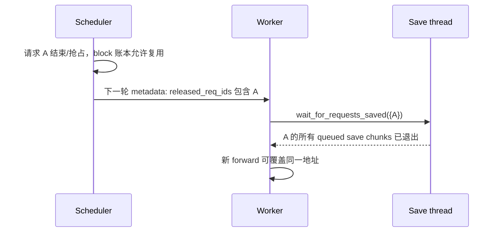

# 06. 并发、资源安全与配置矩阵

基线与源码入口见 [00](../00_source_baseline.md)。本篇围绕“何时允许使用、发布、覆盖、释放”组织。

## 1. 五个不能互相替代的完成点

| 完成点 | 证明了什么 | 不能证明什么 |
|---|---|---|
| 队列 item 完成 | 后台处理了该项 | 全 request、所有 rank 已结束 |
| NPU event 完成 | 指定 stream 已越过记录位置 | 外部对象已 commit |
| layer load 完成 | 当前层恢复可以继续 | 整个模型的层都恢复完成 |
| backend 发布完成 | key 对应完整对象可读 | 本地所有引用都可释放 |
| resource fence 完成 | 此次覆盖/清理依赖已满足 | 其他请求的 I/O 也已结束 |

设备可见性、外部原子发布和本地 block 引用是不同维度。

## 2. 当前普通保存的覆盖保护

`KVPoolScheduler.request_finished*()` 返回 False，不请求上游按 request 延迟 free。`build_connector_meta()` 把 finished ∪ preempted 放入 `released_req_ids`。



普通 `wait_for_save()` 只入队。真正关键的是下一轮物理写入前，`handle_preemptions()` → `handle_released_saves()` → `wait_for_requests_saved()` 完成。

该等待按 released request 筛选，不要求把所有无关请求的保存队列清空。request id 下多个 chunk/job 必须全退出；只等最近一个 batch 不足以证明地址安全。

源码中仍有“saves complete synchronously”的旧注释/文档字符串，但 `add_save_batch()` 执行体与 released fence 才是当前行为依据。当前普通 `done_sending` 返回空集合，不能再绘制 delayed-free→finished_sending 的主链。

## 3. Mamba 的特殊 block 引用

非 layerwise 保存某些 Mamba blocks 时，Scheduler 显式 touch 非 null、非 speculative scratch blocks。worker metadata 的 completed event count 达到预期 Worker 数后再 free。

这里保留的是特定 block 的引用，不是整个请求的 delayed-free 状态。speculative scratch 需要 allocator 独占，不能额外 pin；layerwise 不重复 bulk touch。

## 4. Layerwise 的依赖顺序

共享 slot 的新 owner 不能覆盖旧 owner 仍在使用或保存的数据：

```text
旧 owner producer / save event
  -> 等待旧 owner 的相关保存
  -> 必要时等待 external slot release
  -> attention start gate 允许提交预取
  -> 新 owner load
  -> 本层 load event
  -> Mamba align copy（适用时）
  -> 本层 attention/recurrent compute
  -> 保存或推进下一层
```

具体等待次序还按 GVA/range 分支实现，但上述依赖不可省略。

`AttentionComputeStartGate`：
- 在 attention 提交边界记录 NPU event。
- 预取线程等待 event，使传输与 compute stream 对齐。
- `on_start` / `on_finish` 扩展到 block-key hybrid 的保存与 transfer window。
- `cancel()` 在 abort 后打开 gate 并去掉 callbacks，避免后台永远等待一个不会到达的 attention。

gate 只表示 stream 到达边界，不表示 attention op 完成，也不等于外部 load 完成。

## 5. 保留重叠与末层收口

Mooncake 当前协议 `fence_drains_recv()` 返回 False，让未来层预取继续运行；`send_fence_backlog()` 返回 8，attention 边界限制保存积压，不每层清空全部发送任务。这是当前内部策略，不是公开调参承诺。

每层前依然等待本层所需 load。默认最后一层通过 `_wait_for_final_layer_save()` drain 未完成 PUT；空末层的 event 不能代替前面所有保存完成。

`VLLM_ASCEND_LW_DEFER_LAST_SAVE` 在当前 `pool_worker.py` 中直接读取，默认 `"0"`。启用后把 final drain 延至下一轮 `prepare_layerwise_step()`；teardown 也需处理尾部任务。它属于源码中的可选分支，本体系不把它当默认行为或通用稳定配置。

## 6. Session / lease 清理

| 资源 | 正常完成 | retry / 失败 | terminal 处理 |
|---|---|---|---|
| Mooncake put session | 全范围完成后 commit | revoke 未完成/失败 key | tracker 清请求的 pending owner 记录 |
| Mooncake get session | 跨 chunk 保留必要 session | 释放本次失败 owner，保留可重试请求映射 | 相关 I/O 结束且最后 owner 退出才 end，并删除请求记录 |
| MemCache load lease | 本轮 copy 全部结束后 remove | 失败禁止保存坏结果，按 cleanup/TTL 回收 | drain 后释放资源 |
| partial snapshot | 新旧快照按顺序衔接 | 先保护旧 load，再建立新 save | 清 request 相关状态 |
| 后台线程 | 正常消费任务 | failure 槽 + 提交门控 + 同步点抛出 | stop/join 后 backend.close |

资源清理的时点必须晚于实际 range/copy 使用结束；仅删除 Python dict 不代表 native session 已结束。

shutdown 的实际执行体是先 stop/join 传输线程，清本轮 GVA load lease，再调用 backend `close()`；不能由这个统一方法名推断每个 SDK 都做了完整 session teardown。当前 Mooncake 未覆盖基类的 no-op `close()`，正常/异常路径的 session end/revoke 与进程级 SDK 回收边界需分别看待。

## 7. 核心配置：默认值与真实影响

以下来自当前代码的 extra config；backend SDK 配置文件另表说明。

| 配置 | 当前默认 | 主要影响 |
|---|---|---|
| `backend` | `"mooncake"` | backend、layerwise protocol 和数据面 |
| `use_layerwise` | False | 每层 hooks、piecewise graph、查询与执行路径 |
| `load_async` | False | bulk load 使用后台 recv / waiting-remote；layerwise 不返回此 async 标志 |
| `consumer_is_to_load` | False | consumer 的外部 prefix 查询门控 |
| `consumer_is_to_put` | False | consumer 保存权限 |
| `save_decode_cache` | False | 保存 decode 新形成的完整范围，也参与 `can_put` |
| `discard_partial_chunks` | True | 普通完整 chunk 保存/查询边界 |
| `memcache_dp_init_barrier` | True | MemCache 初始化顺序协调 |
| `layerwise_max_transfer_blocks` | 0 | 批量 blocks 限制，0 不额外限制 |
| `layerwise_max_transfer_bytes` | 0 | 批量 bytes 限制，0 不额外限制 |
| `h2d_stagger_us` | 0 | 逐层 H2D 提交错开 |
| `qos_priority` | 未设置 | backend 注入 QoS，显式设置时只允许整数 0–4，拒绝 bool |

### 7.1 物理复用配置

仅 protocol 接受的模式生效，当前是 MemCache GVA 路径。

| 配置 | 通用 layout 默认 | 含义 |
|---|---|---|
| `layerwise_num_shared_buffers` | `num_layers` | 非独立层的共享 slot 数；默认无复用 |
| `layerwise_prefetch_layers` | `min(shared_buffers, 8)` | 通用 builder 的预取设置；Worker 还按具体 layout 推导窗口 |
| `layerwise_independent_layers` | `[0]` | 独立层列表，也支持 `"all"` / 负索引 |

buffer 数、spec 分桶和实际 `has_layer_reuse` 一起决定是否复用；仅填一个参数不证明最终物理计划已合并。

## 8. 明确的组合边界

| 组合 | 当前代码结论/校验入口 |
|---|---|
| layerwise | `requires_piecewise_for_cudagraph` 返回 True |
| consumer + decode-only save + layerwise + 无 `consumer_is_to_put` | connector 明确拒绝；decode-only 保存采用非 layerwise |
| Mooncake block-key + PCP>1 或 DCP>1 | `validate_topology` 拒绝 |
| Mooncake block-key + P/D TP mismatch | `validate_runtime` 拒绝 |
| Mooncake block-key + PP | namespace 纳入真实 partition；每个 stage 必须持有每个 group 的层，否则拒绝 |
| Mooncake block-key + GVA buffer reuse | protocol `extract_layout_config` 返回 None，不加入该物理复用 |
| 存在 private state 的专用 layerwise | 按 cacheable groups 与 backend 能力校验；不可随意退到普通 KeyLayer |
| bulk TP mismatch | 专门 head-slice 路径；需符合 non-MLA/non-hybrid 等推导条件 |

“代码有某个分支”不等于“任意模型、并行拓扑和 SDK 版本的笛卡尔积都支持”。校验应看 protocol、Worker 和模型 cache spec 三处。

## 9. Backend 配置不与 connector 开关混放

Mooncake 配置由 `MOONCAKE_CONFIG_PATH` 等当前加载逻辑读取，包含 master/metadata 地址、segment/local buffer、`protocol`、tenant、可选 SSD 等；当前 backend 仅接受其实现支持的 `"ascend"` protocol。`enable_ssd_offload` 还依赖 SDK setup 能力和绝对路径校验。

MemCache 配置涉及其 SDK/global resource、内存注册、设备 copy 与 QoS。connector 的 `use_layerwise` 不自动建立 backend 服务，也不证明传输介质、地址与 QoS 配置已正确。

运行示例如需填写 Mooncake master 端口，按本仓库公共约束使用 **50088**；不要把服务地址示例当作已部署环境事实。

下一篇：[07 查询路径](07_lookup_path_design.md)；观测与验证见 [09](09_observability_testing.md)。
